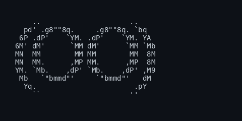

  <a href="README.md">English</a> | <a href="README-pt.md">Português</a>

---

# ----Kaike Almeida do Espirito Santo----

---

**Estudante de Ciência da Computação | Desenvolvedor C | Estudando atualmente: Grafos, Estruturas de Dados e Arquitetura**

---

## `01.` Sobre mim!!

Oiii!! Eu sou o **Kaike**, estudante graduando em Ciência da Computação na **Universidade Federal Rural do Rio de Janeiro (UFRRJ - Instituto Multidisciplinar)**.

Estou no **segundo período**. Tenho interesse em aprender mais sobre arquitetura de computadores, teoria dos grafos e estruturas de dados, pra entender como eles funcionam, se interligam e como podem ser usados para melhorar a minha eficiência na resolução de problemas.

O que eu tenho estudado atualmente envolve projetos em **C**, incluindo algoritmos para reconhecimento de Grafos Fortemente Cordais (Strongly Chordal Graphs) e um jogo que começou como um trabalho para as aulas de Programação Estruturada. Também estou começando a explorar a arquitetura MIPS, por conhecimento, não muito a fundo.

<h3><kbd><b>&nbsp;clique para info sobre mim&nbsp;</b></kbd></h3>

- Estudante de Ciência da Computação na UFRRJ.
- 2º período.
- Aprendendo e desenvolvendo projetos em C.
- Interessado em estruturas de dados, algoritmos e teoria dos grafos.
- Idiomas: Português (Nativo) e Inglês.
- Usuário Linux.

 

  

 

---

## `02.` Tecnologias e Conhecimentos

### Linguagens e ferramentas

| Área | Conhecimento |
|:---|:---|
| Linguagem de programação | C |
| Estruturas de dados | Conceitos básicos e implementação |
| Teoria dos grafos | Grafos cordais e algoritmos |
| Sistema operacional | Linux |
| Controle de versão | Git e GitHub |
| Idiomas | Português e Inglês |

---

## `03.` Trabalhando atualmente em

### Jogo no Terminal — C + Ncurses

  

Atualmente estou desenvolvendo um jogo em **C**, usando principalmente a biblioteca **Ncurses** para criar uma interface baseada em texto diretamente no terminal.

  

  

    <picture>
      
    </picture>
     
    <b>&nbsp;click - Game info and pictures&nbsp;</b>
  

   

  

#### abertura normal

#### abertura menor

---

  

#### versão da prova difícil e com sono

---

  

#### cobrinha

#### jogo da velha

#### campo minado

---

  

#### o quarto

O projeto começou como uma oportunidade durante meu primeiro período para explorar interfaces baseadas em terminal, interação com teclado, renderização de tela e a aplicação prática de conceitos de programação. Também envolve trabalhar com sprites, carregamento de memória e arquivos binários.

 

  
  
  

**Documentação:** Também estou escrevendo meu próprio README explicando os conceitos básicos da Ncurses, suas funções principais e como começar com a biblioteca, já que adquiri um conhecimento bom na feitura do jogo.

Sobre a Ncurses e o jogo em desenvolvimento!

### **Ncurses.md:** **[Ncurses — Conceitos Básicos e Introdução](https://github.com/kaikeaes/while_playing_not_studying-OO-/blob/main/explicancurses.md)**

### **Repositório:** [While Playing Not Studying — Jogo em C](https://github.com/leoeowoeo/while_playing_not_studying-OO-)

# Biblioteca de Grafos Fortemente Cordais

Outro projeto no qual estou trabalhando é uma biblioteca relacionada a **grafos fortemente cordais**, usando estruturas de dados para grafos.

Este projeto envolve o estudo de representações de grafos e a aplicação de estruturas de dados para trabalhar com problemas relacionados a grafos.

  

 

  
  
  

**Repositório:** [Biblioteca de Grafos Fortemente Cordais](https://github.com/kaikea1meida/Grafo.h)

  
  

  

    <picture>
      
    </picture>
     
    <b>&nbsp;click - What is the project about?&nbsp;</b>
  

   

## Reconhecimento de Grafos Fortemente Cordais

Este projeto reconhece se um grafo G é fortemente cordal reduzindo o problema à verificação se o seu grafo de incidência vértice-clique auxiliar H(G) é cordal bipartido.

Nós tentamos não nos apegar aos algoritmos como o da EEPF ( Esquema de Eliminação Perfeita Fore) e ir pra algo diferente.

Também estamos visualizando os grafos através de matrizes de adjacência, olhando apenas para um triângulo (superior ou inferior, dependendo da necessidade).

### Ideia teórica

Um grafo G é fortemente cordal se, e somente se, o seu grafo de incidência vértice-clique H(G) for cordal bipartido.

### Passos

#### 1. Construindo o grafo bipartido auxiliar H(G) = (X ∪ Y, E)

- **Conjunto X (vértices originais):** contém todos os vértices originais de G.
- **Conjunto Y (cliques):** contém nós representando cada clique maximal em G.
- **Arestas:** uma aresta conecta o vértice u em X ao nó de clique C em Y se u pertence a C.

Como construímos:

1. Executar uma Ordem de Eliminação Perfeita (OEP) em G, para termos certeza de que é pelo menos cordal, pois procurar cliques em um grafo não cordal pode ser NP-completo.
   

<kbd><b>&nbsp;sobre o gif&nbsp;</b></kbd>

  ##### *esta imagem não é do nosso projeto, mas representa quase exatamente o que estamos fazendo aqui, ela é de: https://oxfordcontrol.github.io/COSMO.jl/stable/decomposition/*

2. Para cada vértice na OEP, pegamos a sua vizinhança fechada restante.
3. Verificamos se essa vizinhança já está contida em um clique existente em Y. Se não estiver, adicionamos um novo nó de clique a Y e o ligamos a todos os vértices dessa vizinhança.

#### 2. Eliminação bissimplicial em H(G)

- Iterar sobre as arestas (u, v) em H(G), onde u está em X e v está em Y.
- Para cada aresta, verificar se a vizinhança conjunta N(u) ∪ N(v) forma um grafo bipartido completo (biclique).
- Se formar, escolher o vértice bissimplicial (aquele cuja vizinhança fica inteiramente dentro desse biclique).
- Remover esse vértice e todas as suas arestas incidentes de H(G).

#### 3. Explicando o porquê

- "Mas como encontrar (ou não) esses vértices bissimpliciais ajudaria na classificação de um grafo fortemente cordal?" você está se perguntando.
- Essa é a parte interessante do algoritmo que usamos: se encontrarmos um ciclo induzido maior que 4 no bipartido vértice-clique, significa que no grafo original G existe um n-sol (N-sun).
- Por exemplo, se tiver um C6 induzido em H(G), tem um 3-sol induzido em G, ou se tiver um C8, significa que tem um 4-sol induzido.

#### 3-sol induzido e C6 induzido

  
  

#### 4-sol induzido e C8 induzido

  
  

#### 4. Saída

- **Se H(G) terminar completamente vazio:** G é fortemente cordal.
- **Se o loop ficar travado e não conseguir encontrar nenhum vértice bissimplicial:** G não é fortemente cordal.

---

## `04.` Estatísticas do GitHub

---

## `05.` Contato

### email - kaikeaes@gmail.com
### instagram - @kaikea1meida
### discord bacato.

---

**Obrigado pelo seu tempo!!!**

