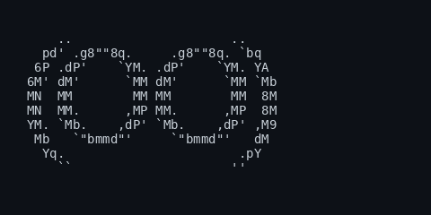

  <a href="README.md">English</a> | <a href="README-pt.md">Português</a>

---

# ----Kaike Almeida do Espirito Santo----

---

**Computer Science Student | C Developer | Graphs & Data Structures**

---

## `01.` About me

Hi!! I'm **Kaike**, a Computer Science undergraduate student at **Universidade Federal Rural do Rio de Janeiro (UFRRJ - Instituto Multidisciplinar)**.

I'm currently in my **second semester**. I'm interested in learning more about computer architecture, graph theory and data structures, to understand how they work, how they interconnect, and how they can be used to improve my problem-solving efficiency.

Most of my current studies involve projects in **C**, including algorithms for recognizing Strongly Chordal Graphs and a game that started as an assignment for my Structured Programming classes. I'm also starting to explore MIPS architecture out of curiosity, not too deeply.

<h3><kbd><b>&nbsp;click info about me&nbsp;</b></kbd></h3>

- Computer Science student at UFRRJ.
- Currently in the 2nd semester.
- Learning and developing projects in C.
- Interested in data structures, algorithms and graph theory.
- Languages: Portuguese (Native) and English.
- Linux user.

 

  

 

---

## `02.` Technologies & Knowledge

### Languages and tools

| Area | Knowledge |
|:---|:---|
| Programming language | C |
| Data structures | Basics and implementation |
| Graph theory | Schordal graphs & algorithms |
| Operating system | Linux |
| Version control | Git & GitHub |
| Languages | Portuguese and English |

---

 
  
## `03.` Working on

### Terminal Game — C + Ncurses

  

I'm currently developing a game in **C**, using mainly the **Ncurses** library to create a text-based interface directly in the terminal.

  

  

    <picture>
      
    </picture>
     
    <b>&nbsp;click - Game info and pictures&nbsp;</b>
  

   

  

#### normal opening

#### smaller opening

---

  

#### tired and hard version of the test

---

  

#### snake

#### tic tak toe

#### minefield

---

  

#### the room

The project started as an opportunity during my first semester to explore terminal-based interfaces, keyboard interaction, screen rendering and the practical application of programming concepts. It also involves working with sprites, memory loading and binary archives.

 

  
  
  

**Documentation:** I'm also writing my own README explaining the basic concepts of Ncurses, its main functions and how to get started with the library, since I acquired good knowledge while building the game.

About Ncurses and the game in development!

### **Ncurses.md:** **[Ncurses — Basic Concepts and Introduction](https://github.com/kaikeaes/while_playing_not_studying-OO-/blob/main/explicancurses.md)**

### **Repository:** [While Playing Not Studying — C Game](https://github.com/leoeowoeo/while_playing_not_studying-OO-)

# Strongly Chordal Graphs Library

Another project I'm working on is a library related to **strongly chordal graphs**, using graph data structures.

This project involves studying graph representations and applying data structures to work with graph-related problems.

  

 

  

  

  

**Repository:** [Strongly Chordal Graphs Library](https://github.com/kaikea1meida/Grafo.h)

  
  

  

    <picture>
      
    </picture>
     
    <b>&nbsp;click - What is the project about?&nbsp;</b>
  

   

  
## Strongly Chordal Graph Recognition

This project recognizes whether a graph G is strongly chordal by reducing the problem to checking if its auxiliary vertex-clique graph H(G) is chordal bipartite.

We tried to use something different from the usual SPEO ( Strong Perfect Elimination ordering), so we looked for different articles

We are also visualizing the graphs through adjacency matrices, looking only at one triangle (upper or lower, depending on the necessity).

### Theoretical idea

A graph G is strongly chordal if and only if its vertex-clique incidence graph H(G) is chordal bipartite.

### Steps

#### 1. Building the auxiliary bipartite graph H(G) = (X ∪ Y, E)

- **Set X (original vertices):** contains all original vertices from G.
- **Set Y (cliques):** contains nodes representing each maximal clique in G.
- **Edges:** an edge connects vertex u in X to clique node C in Y if u belongs to C.

How we build it:

- 1. Run a Perfect Elimination Ordering (PEO) on G, to be sure that it is chordal at least, because looking for cliques in a non-chordal graph may be NP-complete.

<kbd><b>&nbsp;about the gif&nbsp;</b></kbd>

  ##### *this image is not from our project, but it represents almost exactly what we are doing here, it is from: https://oxfordcontrol.github.io/COSMO.jl/stable/decomposition/*

- 2. For each vertex in the PEO, take its remaining closed neighborhood.
- 3. Check if that neighborhood is already contained in an existing clique in Y. If it's not, add a new clique node to Y and link it to all vertices in that neighborhood.

#### 2. Bisimplicial elimination on H(G)

- Loop over the edges (u, v) in H(G), where u is in X and v is in Y.
- For each edge, check if the joint neighborhood N(u) ∪ N(v) forms a complete bipartite graph (biclique).
- If it does, pick the bisimplicial vertex (the one whose neighborhood sits entirely inside this biclique).
- Remove that vertex and all its incident edges from H(G).

#### 3. Explaning why

- "how would finding these bisimplicial vertexes, or not, help on the classification of an Strongly chordal graph?" you may ask
- that is the interesting part of the algorithm that we used, if we find an induced cicle, greater than 4 on the vertex clique bipartite it means that on the original graph G there is an N-sun.
- for example, if there is an induced C6 on H(G) there is an induced 3-Sun in G, ou an C8 that means an induced 4-Sun.

#### induced 3-Sun and induced C6

  
  

#### induced 4-Sun and induced C8

  
  

#### 4. Output

- **If H(G) ends up completely empty:** G is strongly chordal.
- **If the loop gets stuck and can't find any bisimplicial vertices:** G is not strongly chordal.

---

## `04.` GitHub Statistics

---

## `05.` Contact

### email - kaikeaes@gmail.com
### instagram - @kaikea1meida
### discord bacato.

---

**TY for your time!!!**

