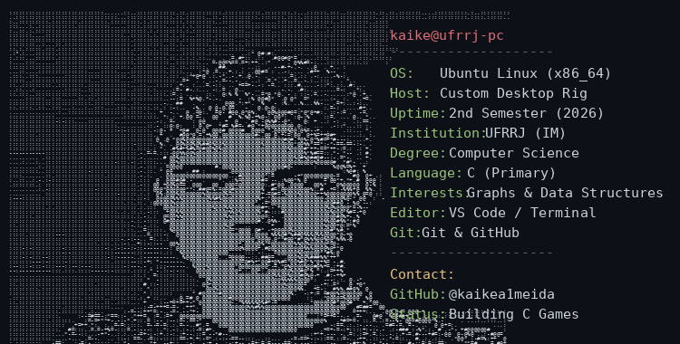

  <a href="README.md">English</a> | <a href="README-pt.md">Português</a>

# Ooooii!!!

## 'Kaike Almeida'

**Computer Science Student | C Developer | Graphs & Data Structures**

---

## `01.` About me

Hi!! I'm **Kaike**, a Computer Science undergraduate student at **Universidade Federal Rural do Rio de Janeiro (UFRRJ - Instituto Multidisciplinar)**.

I'm currently in my **second semester**. I'm interested in learning more about computer architecture, graph theory and data structures, as well as understanding how they work and how they can be used to improve my problem-solving skills.

Most of my current studies involve projects in **C**, including algorithms for recognizing strongly chordal graphs and a game that started as an assignment for my Structured Programming classes. I'm also beginning to explore MIPS architecture.

<h3><kbd><b>&nbsp;click info about me&nbsp;</b></kbd></h3>

- Computer Science student at UFRRJ.
- Currently in the 2nd semester.
- Learning and developing projects in C.
- Interested in data structures, algorithms and graph theory.
- Languages: Portuguese (Brazilian) and English.
- Linux user.

<h3><kbd><b>&nbsp;click - Fastfetch me!&nbsp;</b></kbd></h3>

 

  

 

---

## `02.` Technologies & Knowledge

### Languages and tools

| Area | Knowledge |
|:---|:---|
| Programming language | C |
| Data structures | Basics and implementation |
| Graph theory | Schordal graphs & algorithms |
| Operating system | Linux |
| Version control | Git & GitHub |
| Languages | Portuguese and English |

---

## `03.` Working on

### Terminal Game — C + Ncurses

  

I'm currently developing a game in **C**, using mainly the **Ncurses** library to create a text-based interface directly in the terminal.

  
<h3><kbd><b>&nbsp;click - Game info and pictures&nbsp;</b></kbd></h3>

  

The project started as an opportunity during my first semester to explore terminal-based interfaces, keyboard interaction, screen rendering and the practical application of programming concepts. It also involves working with sprites, memory loading and binary archives.

 

  
  
  

**Documentation:** I'm also writing my own README explaining the basic concepts of Ncurses, its main functions and how to get started with the library.

About Ncurses and the in development game!

### **Ncurses.md:** **[Ncurses — Basic Concepts and Introduction](https://github.com/kaikeaes/while_playing_not_studying-OO-/blob/main/explicancurses.md)**

### **Repository:** [While Playing Not Studying — C Game](https://github.com/leoeowoeo/while_playing_not_studying-OO-)

# Strongly Chordal Graphs Library

Another project I'm working on is a library related to **strongly chordal graphs**, using graph data structures.

This project involves studying graph representations and applying data structures to work with graph-related problems.

  

 

  
  
  

**Repository:** [Strongly Chordal Graphs Library](https://github.com/kaikea1meida/Grafo.h)

<h3><kbd><b>&nbsp;click - What is the project about?&nbsp;</b></kbd></h3>

## Strongly Chordal Graph Recognition

This project recognizes whether a graph G is strongly chordal by reducing the problem to checking if its auxiliary vertex-clique graph H(G) is chordal bipartite.

We are also visualizing the graphs  trough adjacency matrices, only looking at one triangle ( superior or inferior depending on the necessity)
### Theoretical idea

A graph G is strongly chordal if and only if its vertex-clique incidence graph H(G) is chordal bipartite.

### Steps

#### 1. Building the auxiliary bipartite graph H(G) = (X ∪ Y, E)

- **Set X (original vertices):** contains all original vertices from G.
- **Set Y (cliques):** contains nodes representing each maximal clique in G.
- **Edges:** an edge connects vertex u in X to clique node C in Y if u belongs to C.

How we build it:

1. Run a Perfect Elimination Ordering (PEO) on G, so that we are sure that it is cordal at least, because looking for cliques in a non cordal graph may be NP-complete.

<kbd><b>&nbsp;about the gif&nbsp;</b></kbd>

  ##### *this image is not from our project but it represents almost exactly what we are doing here, it is from: https://oxfordcontrol.github.io/COSMO.jl/stable/decomposition/*

2. For each vertex in the PEO, take its remaining closed neighborhood.
3. Check if that neighborhood is already contained in an existing clique in Y. If it's not, add a new clique node to Y and link it to all vertices in that neighborhood.

#### 2. Bisimplicial elimination on H(G)

- Loop over the edges (u, v) in H(G), where u is in X and v is in Y.
- For each edge, check if the joint neighborhood N(u) ∪ N(v) forms a complete bipartite graph (biclique).
- If it does, pick the bisimplicial vertex (the one whose neighborhood sits entirely inside this biclique).
- Remove that vertex and all its incident edges from H(G).

#### 3. Output

- **If H(G) ends up completely empty:** G is strongly chordal.
- **If the loop gets stuck and can't find any bisimplicial vertices:** G is not strongly chordal.

---

## `04.` GitHub Statistics

---

## `05.` Contact

### email - kaikeaes@gmail.com
### instagram - @kaikea1meida
### discord bacato.

---

**TY for your time!!!**

